# IssueTrack

A full-stack, production-ready **Jira-style issue & bug tracker** built with the MERN stack
(MongoDB · Express · React · Node) and TypeScript end to end.

Teams create projects, track issues on a Kanban board, filter and search across everything, comment,
upload screenshots and see each other's changes **live** — with real role-based permissions enforced in the
API, not just hidden in the UI.

**🔗 Live demo: https://issuetrack-eight.vercel.app** — click any *Try a demo account* card on the sign-in page
(Owner, Admin, Member or Viewer) to explore with seeded data, or create your own account.

<p align="center">
  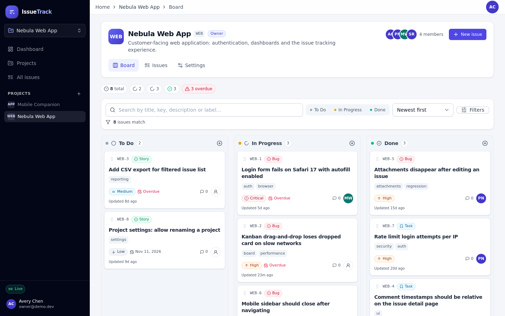
</p>

---

## Table of contents

- [Live feature tour](#live-feature-tour)
- [Screenshots](#screenshots)
- [Tech stack](#tech-stack)
- [Architecture](#architecture)
- [Folder structure](#folder-structure)
- [Quick start](#quick-start)
- [Environment variables](#environment-variables)
- [Commands](#commands)
- [Demo data & credentials](#demo-data--credentials)
- [API](#api)
- [Roles & permissions](#roles--permissions)
- [Tests & verification](#tests--verification)
- [Deployment](#deployment)
- [Security notes](#security-notes)
- [Known limitations](#known-limitations)

---

## Live feature tour

**Auth & accounts**
Email + password sign-up/sign-in, optional **"Continue with Google" via Clerk** (the API verifies the
Clerk session token server-side before issuing its own session), one-click demo accounts, JWT in an httpOnly cookie, session bootstrap on reload, logout,
profile editing, password change, protected client routes with redirect-back-to-intended-page.

**Projects**
Dashboard and project list, create/edit/delete with confirmation, unique 2–10 character project keys that
prefix every issue (`WEB-12`), add registered members by email, remove members, change roles
(owner / admin / member / viewer), project switcher, breadcrumbs, project settings with a danger zone that is
visible only to the owner.

**Issues**
Full CRUD with title, description, type (bug/task/story), priority (low/medium/high/critical),
status (To Do / In Progress / Done), assignee, labels, due date and screenshot attachments.
Reporter, assignee, created/updated timestamps, comment thread and a complete activity history on every issue.
Auto-incrementing per-project keys, assign/unassign, priority changes, label add/remove, attachment add/remove.

**Kanban**
Three columns with dnd-kit drag & drop (mouse, touch and keyboard), status persisted through the API and
broadcast over Socket.io, optimistic cards with rollback, per-column counts, card metadata
(key, type, priority, labels, assignee avatar, due date, comment count) and a **fallback status menu** on
every card so drag & drop is never the only way to move an issue.

**Issue explorer**
Server-side search (title, key, description, labels) plus filters for status, priority, type, assignee,
reporter, label and due-date range; sorting by newest/oldest/priority/due date/recently updated; pagination;
**all state in the URL** so any view is shareable; clear-filters, result count and empty states.

**Collaboration**
Comments (add, edit, delete your own — admins/owners can delete any), edited markers, relative timestamps,
avatars/initials, activity timelines at project and issue level, and live updates for issue, comment,
attachment and member events across sessions.

**UX**
Responsive layout with a mobile drawer, skeletons, spinners, error boundary, empty states, toast feedback,
accessible dialogs (focus trap + Esc), labelled inputs, visible focus rings, keyboard navigation and
status/priority badges that pair icons with text — colour is never the only signal.

---

## Screenshots

All images are real captures of the seeded demo dataset, produced by [`e2e/screenshots.mjs`](e2e/screenshots.mjs).

| | |
| --- | --- |
| **Dashboard**<br>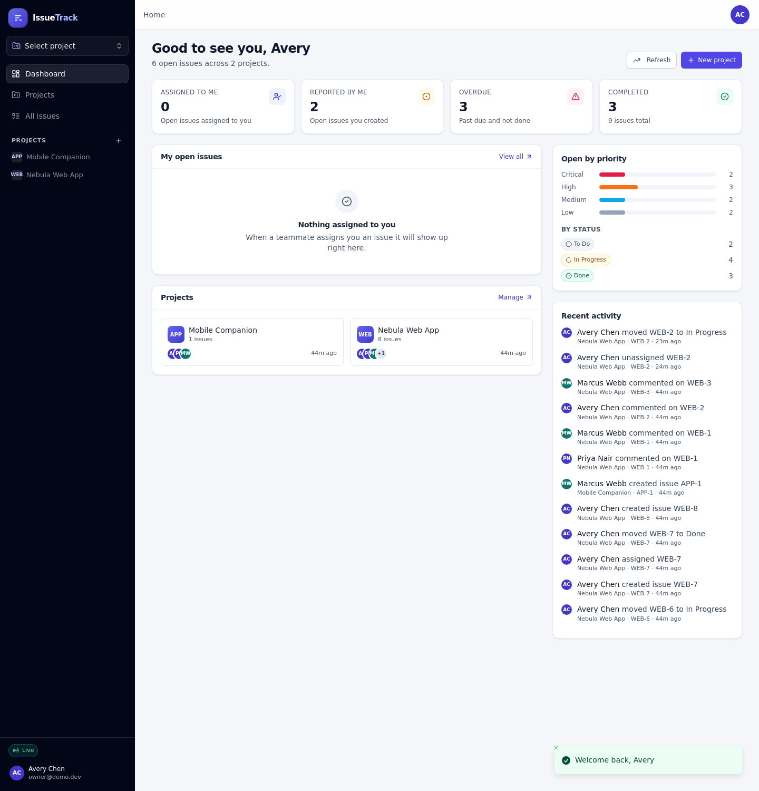 | **Kanban board**<br> |
| **Issue detail**<br>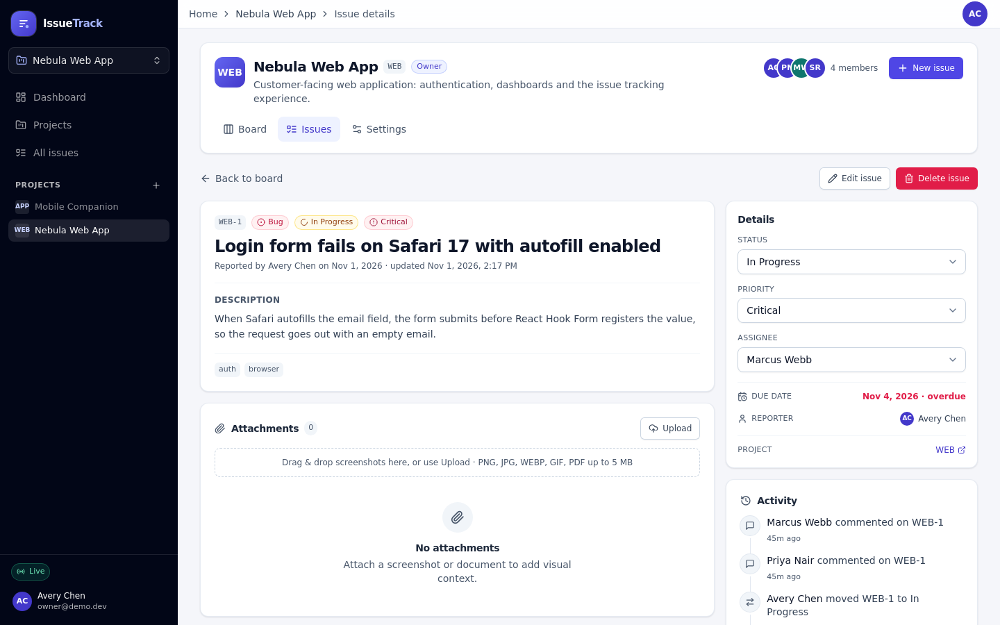 | **Comments & attachments**<br>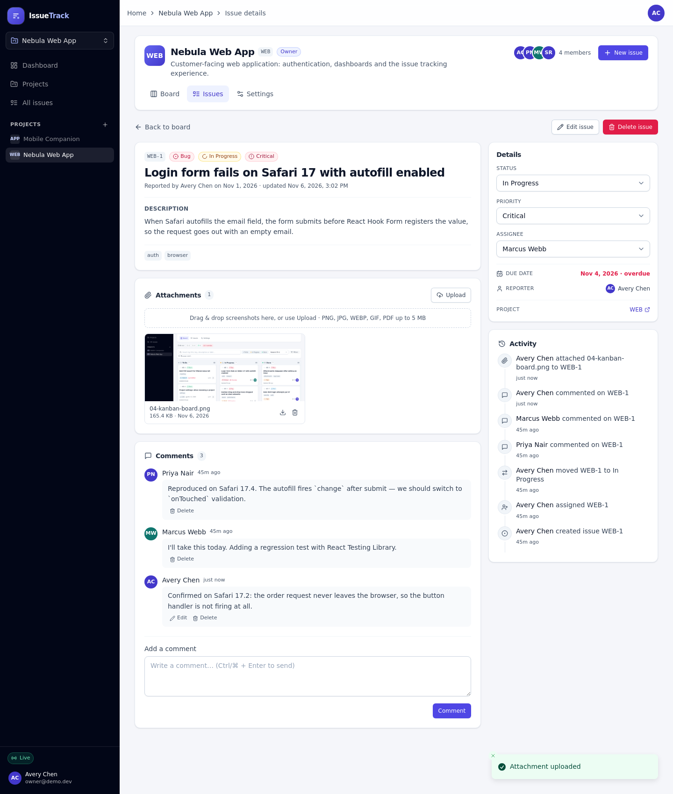 |
| **Issue list with filters**<br>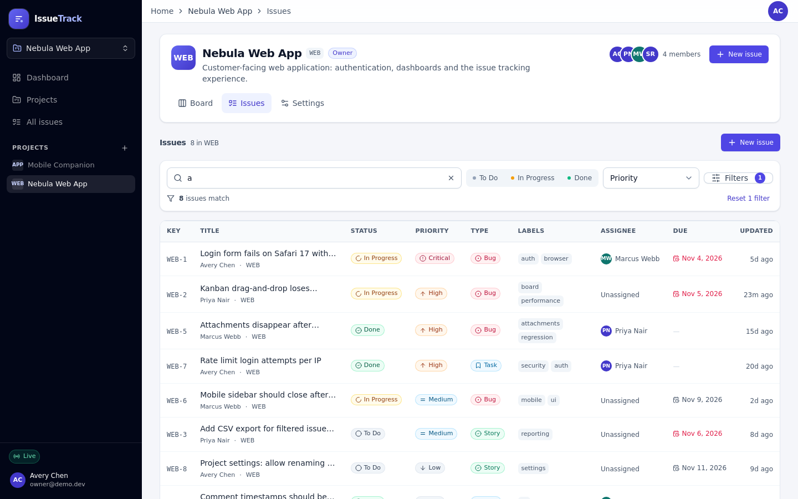 | **Cross-project explorer**<br>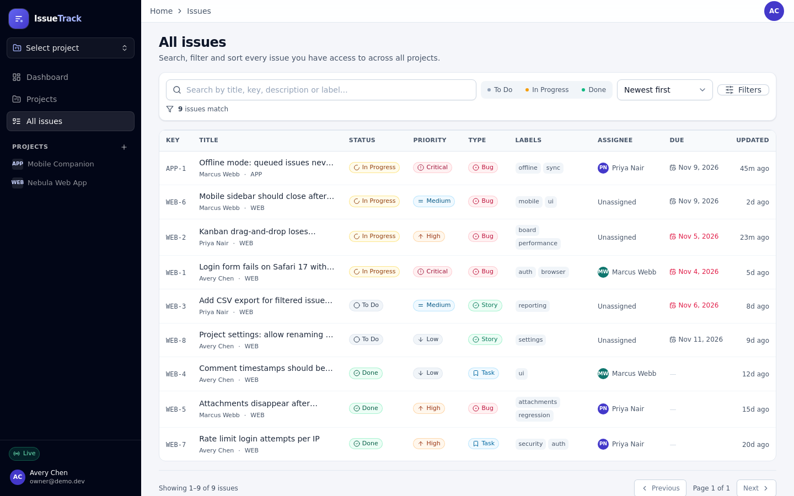 |
| **Drag & drop persisted**<br>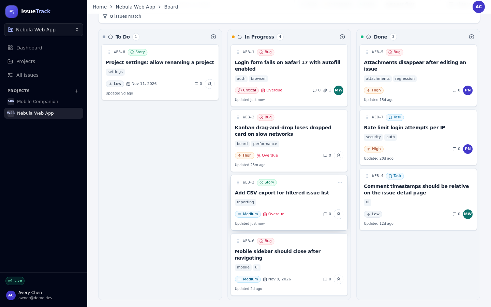 | **Project settings & members**<br>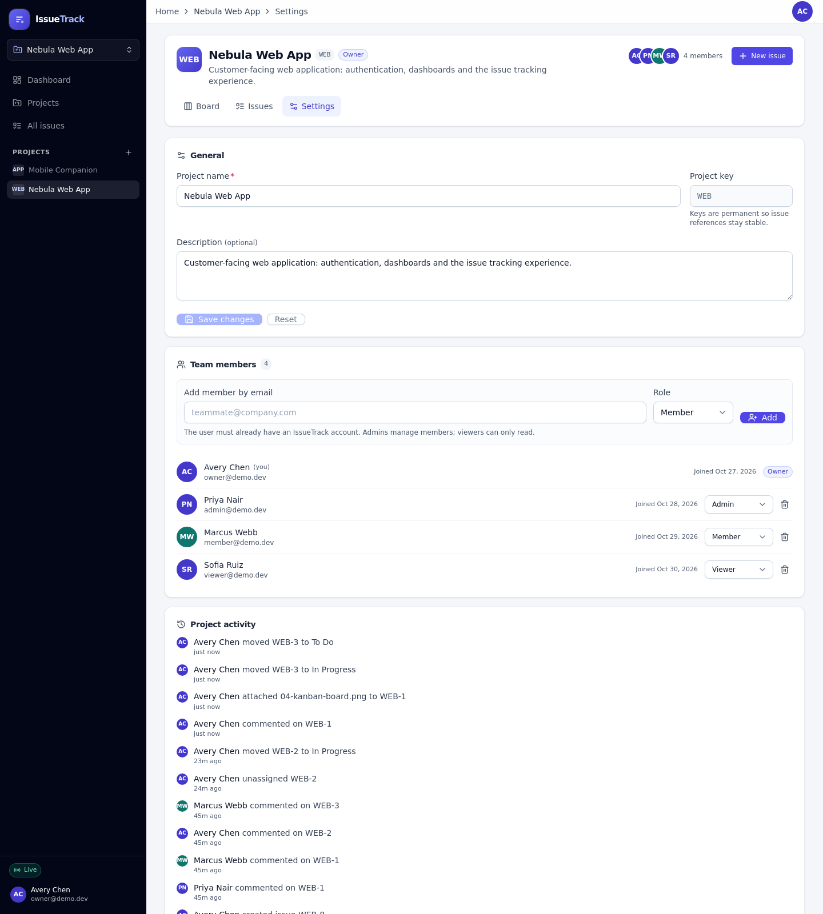 |
| **Sign in**<br>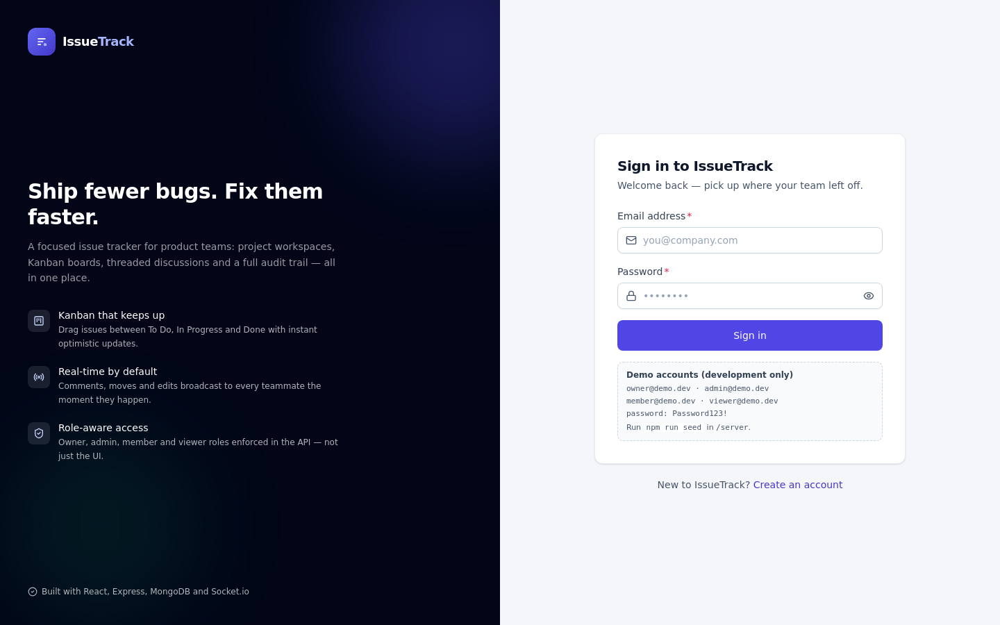 | **Projects**<br>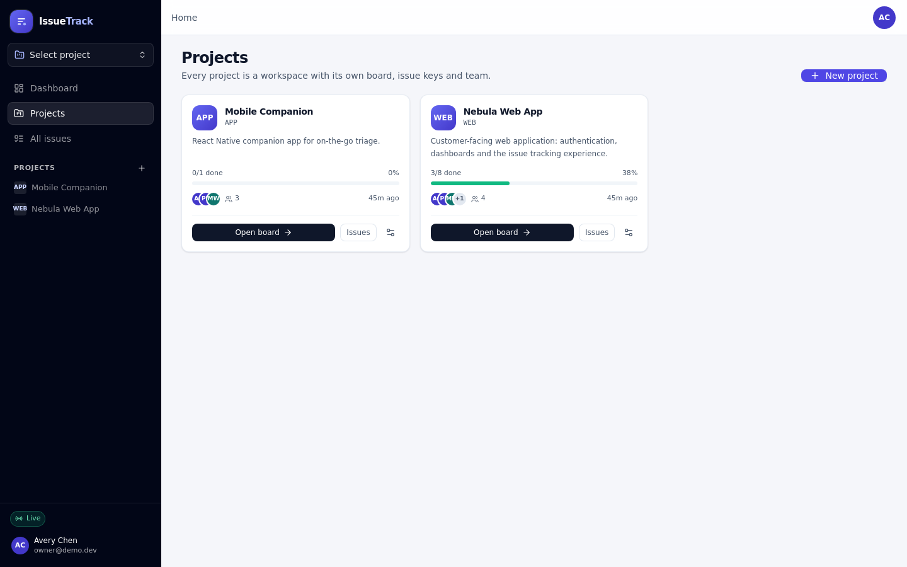 |
| **Mobile dashboard (390 px)**<br>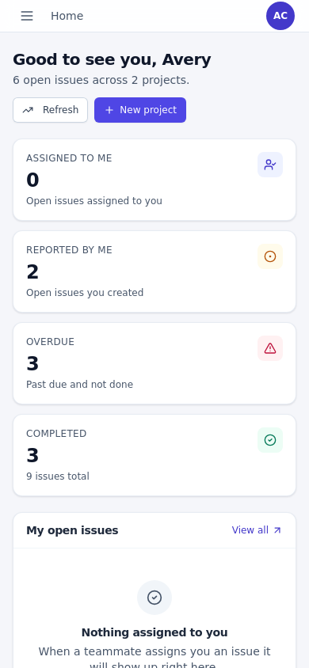 | **Mobile board**<br>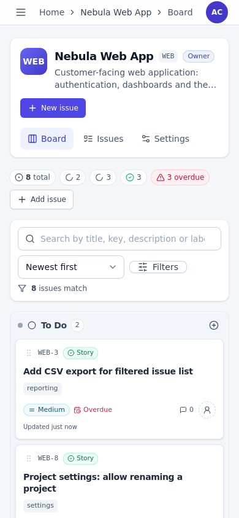 |

Regenerate them (API + web running on the seeded database):

```bash
cd e2e && npm install && npx playwright install chromium && npm run screenshots
```

## Tech stack

**Client** — React 18 · TypeScript (strict) · Vite 5 · Tailwind CSS · React Router 6 · TanStack Query 5 ·
React Hook Form + Zod · dnd-kit · Axios · Socket.io client · Lucide icons · Sonner toasts ·
Vitest + React Testing Library.

**Server** — Node 20 · Express 4 · TypeScript (strict) · Mongoose 8 · JWT (jsonwebtoken) · bcryptjs ·
Zod validation · Helmet · CORS · express-rate-limit · Multer uploads · Socket.io · dotenv ·
centralized error middleware · Jest + Supertest.

**Tooling** — ESLint + Prettier in both packages, TypeScript strict mode, Docker Compose, Vercel config,
Render blueprint, OpenAPI 3 description, Playwright browser journey.

---

## Architecture

```
browser ──HTTPS /api (httpOnly cookie)──▶ Express (routes → controllers → services → models) ──▶ MongoDB
        ──WSS /socket.io───────────────▶ Socket.io rooms (project:<id>, user:<id>)          ──▶ disk uploads
```

* **Layered API** — validation (Zod) → auth → resource loader (`loadProject` / `loadIssue` resolves membership
  and role) → thin controller → service (business rules, activity log, realtime emit) → serializer (DTO).
  Controllers never touch Mongoose directly and models never reach the client un-serialised.
* **Project isolation** — every project/issue route resolves the caller's role first; non-members get `403`,
  unknown ids `404`. Socket rooms are joined from the same membership query, so realtime cannot leak data.
* **Typed end to end** — the client consumes the same DTO shapes the server serialises (`client/src/types`),
  and the form schemas mirror the server validators.
* **Server state in one place** — TanStack Query owns all remote data; the realtime provider invalidates the
  same keys the mutations use, so a Socket.io event and a local mutation are indistinguishable to the UI.

Full details: [`docs/architecture.md`](docs/architecture.md).

---

## Folder structure

```
.
├── client/                        # React + TypeScript SPA (Vite)
│   ├── src/
│   │   ├── components/
│   │   │   ├── ui/                # Button, FormControls, Badge, Avatar, Modal, Menu, Feedback, Pagination
│   │   │   ├── layout/            # AppLayout, Sidebar, Header, ProjectLayout, ProjectSwitcher
│   │   │   ├── issues/            # KanbanBoard, IssueCard, IssueTable, IssueFormModal, IssueFilterBar,
│   │   │   │                      #   CommentSection, AttachmentSection, ActivityTimeline, LabelInput
│   │   │   ├── projects/          # MembersPanel, ProjectFormModal
│   │   │   ├── auth/              # ProtectedRoute, PublicOnlyRoute
│   │   │   └── ErrorBoundary.tsx
│   │   ├── context/               # ProjectContext (role + permission helpers)
│   │   ├── hooks/                 # useAuth, useRealtime, useProjects, useMembers, useIssues, useIssueDetail…
│   │   ├── lib/                   # api.ts, queryKeys, queryClient, schemas, filterParams, constants, utils
│   │   ├── pages/                 # Login, Register, Dashboard, Projects, Board, ProjectIssues, AllIssues,
│   │   │                          #   IssueDetail, ProjectSettings, Profile, NotFound
│   │   ├── test/                  # vitest setup + render helpers
│   │   └── types/                 # DTOs shared with the API
│   ├── nginx.conf · Dockerfile · vercel.json
│   └── .env.example
├── server/                        # Express + TypeScript API
│   ├── src/
│   │   ├── config/                # env (Zod-validated), db connection
│   │   ├── constants/             # domain enums + role ranking
│   │   ├── controllers/           # auth, user, project, issue, collaboration, dashboard
│   │   ├── middleware/            # auth, projectAccess, validate, upload, rateLimit, errorHandler
│   │   ├── models/                # User, Project, Issue, Comment, Activity
│   │   ├── policies/              # pure permission helpers
│   │   ├── realtime/              # socket bootstrap + emitters
│   │   ├── routes/                # auth, users, projects, issues, dashboard
│   │   ├── seed/                  # demo data script
│   │   ├── serializers/           # model → DTO
│   │   ├── services/             # auth, project, issue, comment, attachment, activity, dashboard
│   │   ├── utils/                 # ApiError, jwt, cookies, response, asyncHandler
│   │   ├── validators/            # Zod schemas
│   │   ├── app.ts                 # express app factory (middleware order)
│   │   └── index.ts               # http + socket server bootstrap
│   ├── tests/                     # Jest + Supertest suites
│   ├── Dockerfile · .env.example
├── docs/
│   ├── api.md                     # endpoint reference
│   ├── openapi.yaml               # OpenAPI 3 spec
│   ├── architecture.md            # deep dive
│   ├── deployment.md              # Atlas + Render/Railway + Vercel
│   └── screenshots/               # images used above
├── e2e/                           # optional Playwright journey (18 steps)
├── docker-compose.yml             # mongo + api + nginx-served client
├── render.yaml                    # Render blueprint for the API
└── .env.example
```

---

## Quick start

### Prerequisites

Node **20+**, npm 10+, and a MongoDB you can reach — either a local `mongod`, the
`docker compose up mongo` service, or a free [MongoDB Atlas](https://www.mongodb.com/atlas) cluster.

### 1. Install

```bash
git clone <your-repo-url> issuetrack && cd issuetrack
npm install                  # root tooling (concurrently, used by `npm run dev`)
npm run install:all          # installs /server and /client
```

### 2. Configure

```bash
cp server/.env.example server/.env
cp client/.env.example client/.env.local
# edit server/.env: at minimum set JWT_SECRET (openssl rand -hex 48) and MONGODB_URI
```

### 3. Seed demo data (optional but recommended)

```bash
npm run seed                 # ≈9 issues across 2 projects, comments, activity, 4 users
```

### 4. Run

```bash
npm run dev                  # API on :4000, web on :5173 (concurrently)
# or separately:
npm run dev:server
npm run dev:client
```

Open **http://localhost:5173** and sign in with a demo account (below).

### 5. Docker (alternative, no local Node/Mongo needed)

```bash
cp .env.example .env         # set JWT_SECRET + SEED_DEMO_PASSWORD
docker compose up --build -d
docker compose exec api npm run seed
# web → http://localhost:8080, api → http://localhost:4000/api/health
```

---

## Environment variables

Full tables live in [`docs/deployment.md`](docs/deployment.md#5-environment-variables). The essentials:

| API (`server/.env`) | Purpose |
| ------------------- | ------- |
| `MONGODB_URI` | Mongo connection string (local or Atlas) |
| `JWT_SECRET` | ≥32 random chars — signs session and file tokens |
| `CLIENT_ORIGIN` | Comma-separated allowed browser origins (CORS + credentials) |
| `COOKIE_SECURE` / `COOKIE_SAME_SITE` | `true` / `none` when the SPA is on another site (Vercel + Render) |
| `CLERK_SECRET_KEY` | Optional — Clerk secret key (`sk_test_…`); enables Google/GitHub sign-in |
| `PORT`, `JWT_EXPIRES_IN`, `COOKIE_NAME`, `UPLOAD_DIR`, `MAX_UPLOAD_MB`, rate-limit pairs | Optional tuning |

| Client (`client/.env.local`) | Purpose |
| ---------------------------- | ------- |
| `VITE_API_URL` | Full API base (`https://api.example.com/api`); leave empty in dev to use the Vite proxy |
| `VITE_PROXY_TARGET` | Dev proxy target, default `http://localhost:4000` |
| `VITE_CLERK_PUBLISHABLE_KEY` | Optional — Clerk publishable key (`pk_test_…`) from the same Clerk app |

### Clerk sign-in (Google)

1. Sign the Clerk CLI in once: `npx -y clerk@latest auth login`.
2. Pull the development keys straight into the env files (nobody has to copy secrets by hand):
   `npx -y clerk@latest env pull --file .env` inside `server/`, and
   `npx -y clerk@latest env pull --file .env.local` inside `client/` (then delete the `CLERK_SECRET_KEY` line from the
   client file — the browser only needs `VITE_CLERK_PUBLISHABLE_KEY`). Social providers are configured under
   **User & authentication → Social connections** in the [Clerk dashboard](https://dashboard.clerk.com).
3. Restart `npm run dev`. The button appears only when **both** keys are set.

How it stays secure: the browser sends only Clerk's short-lived session token to `POST /api/auth/clerk`. The API
verifies its signature, expiry and authorised origin with `@clerk/backend`, reads the user's **verified** primary
email from Clerk, then finds or creates the matching IssueTrack account and sets the usual JWT cookie. Sending an
email address by itself is rejected.

No real credentials are committed — only the `*.env.example` templates.

---

## Commands

| Command (root) | What it does |
| -------------- | ------------ |
| `npm run install:all` | Install both packages |
| `npm run dev` | Run API (:4000) + Vite dev server (:5173) together |
| `npm run seed` | Wipe and reseed demo data |
| `npm run build` | Build the API (`tsc`) and the SPA (`vite build`) |
| `npm start` | Run the compiled API (`server/dist`) |
| `npm test` | Server Jest suite + client Vitest suite |
| `npm run lint` | ESLint in both packages |
| `npm run typecheck` | `tsc --noEmit` in both packages |
| `npm run verify` | lint → typecheck → tests → build (the full gate) |

Per package: `npm run test:coverage` (server Jest coverage, client V8 coverage),
`npm run format` / `format:check`, `npm run dev`, `npm run build`, `npm run start`.
Client extras: `npm run preview`, `npm run test:watch`.

---

## Demo data & credentials

`npm run seed` (development only) creates:

| Role | Email | Password |
| ---- | ----- | -------- |
| Owner | `owner@demo.dev` | `Password123!` |
| Admin | `admin@demo.dev` | `Password123!` |
| Member | `member@demo.dev` | `Password123!` |
| Viewer | `viewer@demo.dev` | `Password123!` |

(The password is `SEED_DEMO_PASSWORD` from `server/.env`; change it there before seeding anything shared.
These accounts exist **only** in your development database — the seed script is never run in production.)

Seeded content: two projects — **WEB** *Nebula Web App* (owner + 3 members, 8 issues spread across all three
statuses and all four priorities, labels, due dates, assignees, comments, activity history) and
**APP** *Mobile Companion* (1 issue) — so you can test `owner`/`admin`/`member`/`viewer` permissions
immediately. Try: sign in as `viewer@demo.dev` and confirm every edit control disappears and the API still
returns `403` if you call it directly.

---

## API

* Human-readable reference: [`docs/api.md`](docs/api.md)
* Machine-readable spec: [`docs/openapi.yaml`](docs/openapi.yaml) (validated with `@redocly/cli`)

```
/api/auth        register · login · logout · me
/api/users       me · lookup · search
/api/projects    list · create · detail · update · delete · stats · labels · activity
/api/projects/:projectId/members      list · add · change role · remove
/api/projects/:projectId/issues       list (search/filter/sort/paginate) · board · create
/api/issues      cross-project explorer
/api/issues/:issueId                  detail · update · delete · status · assignee
/api/issues/:issueId/comments         list · create · update · delete
/api/issues/:issueId/attachments      upload · delete · download (signed token)
/api/issues/:issueId/activity         audit trail
/api/dashboard   aggregated dashboard payload
/api/health      liveness probe
```

Conventions: `{ success, data, meta }` on success, `{ success:false, error:{ message, code, details? } }` on
failure, correct status codes (400/401/403/404/409/413/429/500), pagination metadata on list endpoints, and
Socket.io events for every mutation (`issue:created`, `issue:updated`, `comment:created`, `attachment:deleted`,
`project:members.updated`, `activity:created`, …).

---

## Roles & permissions

| Capability | Viewer | Member | Admin | Owner |
| ---------- | :----: | :----: | :---: | :---: |
| Browse project, issues, comments, activity | ✅ | ✅ | ✅ | ✅ |
| Create issues | — | ✅ | ✅ | ✅ |
| Edit issues | — | own/assigned only | any | any |
| Delete issues | — | own (reporter) | any | any |
| Comment | — | ✅ | ✅ | ✅ |
| Edit/delete comments | — | own | own + any | own + any |
| Upload/remove attachments | — | own/assigned issues | any | any |
| Edit project / manage members | — | — | ✅ | ✅ |
| Change member roles | — | — | ✅ | ✅ |
| Delete project | — | — | — | ✅ |

These rules live in `server/src/policies/permissions.ts` and are re-checked inside the services, so they hold
for direct API calls as well as the UI (which mirrors them via `client/src/lib/utils.ts`).

---

## Tests & verification

| Suite | Command | Result |
| ----- | ------- | ------ |
| Server (Jest + Supertest, real MongoDB test DB) | `npm run test:server` | **42 passing** — auth (register/login/invalid/tampered token), protected routes, project roles, member management, issue CRUD, filters/search/sort/pagination, status transitions, comment & attachment permissions, activity log |
| Client (Vitest + RTL) | `npm run test:client` | **31 passing in 6 files** — login validation, protected-route behaviour, create-issue validation, Kanban status change (optimistic + rollback), mutation error handling, loading/empty/error states |
| Types & lint | `npm run typecheck`, `npm run lint` | Clean in both packages (TypeScript strict) |
| Builds | `npm run build` | API `tsc` + SPA `vite build` succeed |
| Browser journey (optional) | `cd e2e && npm run journey` | **18/18 steps** in Chromium — register → project → members → issues → assign → comment → attachment → filter/search → drag & drop → realtime in a second session → outsider 403 → mobile drawer → logout → post-login redirect |

Server tests expect a reachable MongoDB at `MONGODB_URI_TEST` (default
`mongodb://127.0.0.1:27017/issuetrack_test`, dropped before the run — never point it at your app database).

---

## Deployment

**Live deployment (Vercel + MongoDB Atlas)** — https://issuetrack-eight.vercel.app

The whole app runs as one Vercel project: the SPA is served from `client/dist`, and `api/index.ts` wraps the same
Express app as a Vercel Function at `/api`, so browser and API share an origin (no cross-site cookies). The database
is a free MongoDB Atlas cluster created from the project's **Storage** tab, which injects `MONGODB_URI`. On first boot
the function seeds the demo dataset exactly once (guarded by a lock document, so concurrent cold starts can't collide).
Project environment variables: `NODE_ENV=production`, `JWT_SECRET`, `COOKIE_SECURE=true`, `COOKIE_SAME_SITE=lax`,
`TRUST_PROXY=true`, `VITE_REALTIME=off`, `VITE_CLERK_PUBLISHABLE_KEY`, plus `CLERK_SECRET_KEY` to enable Google
sign-in. Every push to `main` redeploys. Serverless functions cannot hold Socket.io connections, so live updates are
off on Vercel (the UI still refreshes after every change); use Render/Railway (below) if you need realtime in production.

Step-by-step instructions for the other targets, with every variable and dashboard setting:
[`docs/deployment.md`](docs/deployment.md).

| Piece | Target | Config in this repo |
| ----- | ------ | ------------------- |
| Database | MongoDB Atlas (free M0) | connection string in `MONGODB_URI` |
| API | Render (blueprint) or Railway | `render.yaml`, `server/Dockerfile` |
| Web | Vercel | `client/vercel.json` (SPA rewrites + security headers) |
| Local/all-in-one | Docker Compose | `docker-compose.yml` (`mongo` + `api` + nginx `web`) |

Required for a cross-site production deploy (Vercel SPA + Render API):
`MONGODB_URI`, `JWT_SECRET` (generated), `CLIENT_ORIGIN=https://<your-vercel-app>`,
`COOKIE_SECURE=true`, `COOKIE_SAME_SITE=none`, and on Vercel `VITE_API_URL=https://<api-host>/api`.
Nothing else is needed — no credentials are baked into the repo.

---

## Security notes

* **Passwords** — bcrypt (cost 12), never returned by any endpoint or logged.
* **Sessions** — JWT in an httpOnly, SameSite cookie (`Secure` in production); `Authorization: Bearer` is
  supported for non-browser clients. Logout clears the cookie and the client-side cache.
* **Validation everywhere** — every body, query string and route param passes a Zod schema; unknown keys are
  stripped, so mass-assignment is not possible.
* **Authorization, not UI-only** — `loadProject`/`loadIssue` resolve membership and role before any handler;
  issue-level rules are re-checked in the service layer.
* **Uploads** — MIME allow-list, 5 MB / 5-file caps, randomised filenames, path-traversal-guarded deletion,
  downloads require a short-lived signed token (15 min) instead of the session cookie.
* **Transport & headers** — Helmet, strict CORS allow-list with credentials (`CLIENT_ORIGIN` plus optional
  `CLIENT_ORIGIN_PATTERNS` wildcards for hosted previews, e.g. `https://*.vercel.app`), compression,
  body-size limits. A rejected origin answers `403 CORS_NOT_ALLOWED` naming the offending origin instead of
  an opaque 500.
* **Rate limiting** — tight limiter on `/api/auth/*`, global limiter on `/api`.
* **Error hygiene** — a single error middleware maps known failures to safe messages and codes; stack traces
  and driver/internal details are never sent (and 5xx messages collapse to “Something went wrong” in prod).
* **No secrets in the repo** — only `.env.example` templates; `.env*`, uploads, `dist/` and coverage are ignored.

---

## Known limitations

Only genuinely unavoidable ones:

* **Attachments are stored on the API host's local disk.** That works on a VM/Render disk/Railway volume
  (a 1 GB disk is declared in `render.yaml`), but it is not shared between multiple API instances — for
  horizontal scaling, swap `multer` disk storage for S3/R2 (one module: `server/src/middleware/upload.ts`).
* **No email delivery** — there is no mail provider configured, so password reset and email invitations are
  out of scope; members are added by the email of an already-registered user.
* **Rate limiting is in-memory** — correct for a single instance; behind several instances each keeps its own
  counters (a Redis store would be the drop-in fix).
* **Realtime is per-instance unless you add an adapter** — Socket.io broadcasts on one Node process; multiple
  instances need `@socket.io/redis-adapter`. The single-instance deployment in `render.yaml` needs nothing.
* **The Playwright journey is not part of `npm test`** — it needs a running API/web pair and a Chromium
  download, so it lives in `e2e/` with its own instructions instead of gating CI.

---

<p align="center"><sub>Built as a complete, self-contained reference implementation — clone it, run it, break it, extend it.</sub></p>
